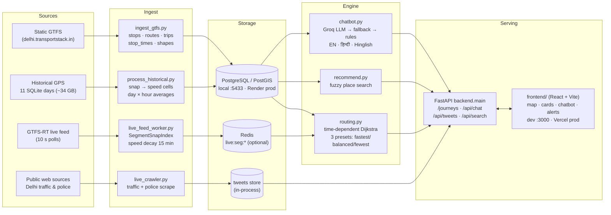
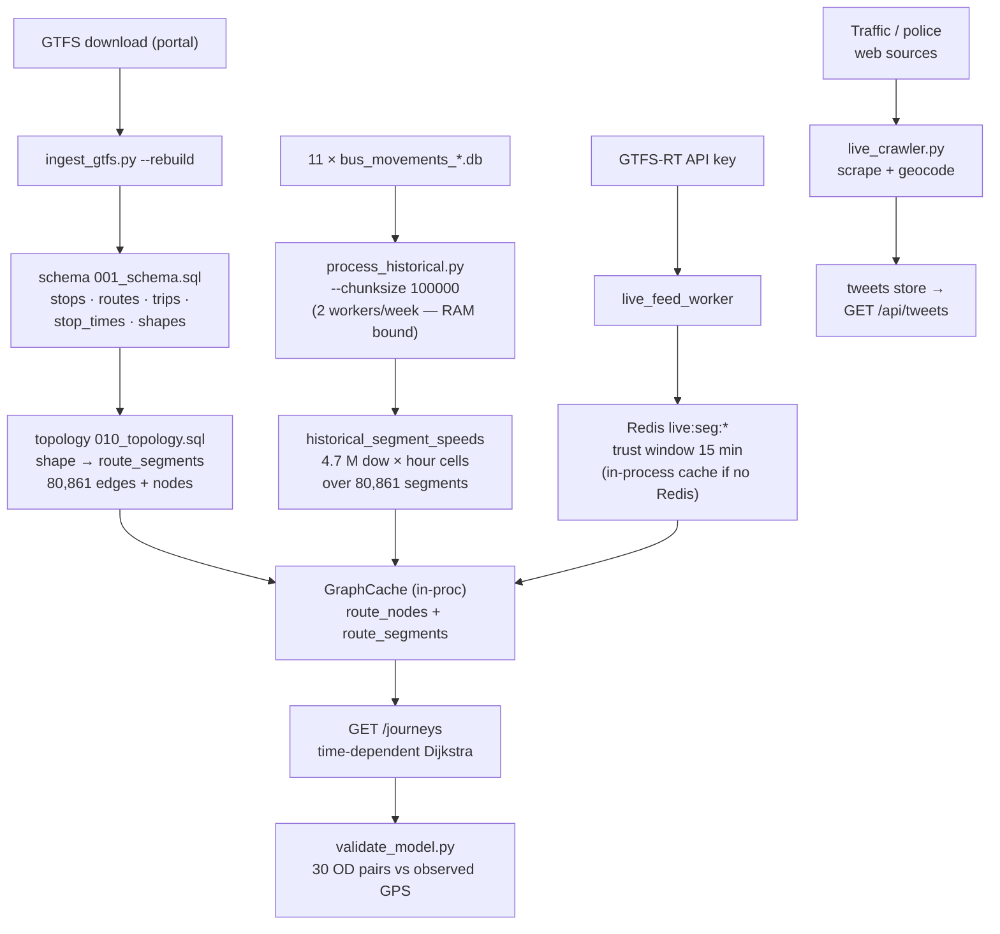
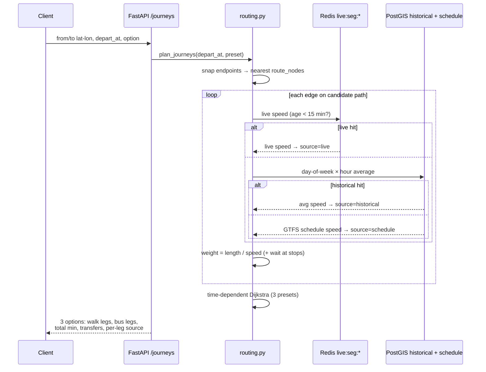

# commuttify — Real-time Bus Traffic Model & Journey Planner (Delhi)

**Delhi Transport Stack Hackathon 2026**:
a traffic model built from real-time + historical Delhi bus GPS data, and a
Google-Maps-like **journey planning API that computes ETAs itself** — no
Google Directions calls in the serving path.

## What it does

- **Own routing API** — `GET /journeys` plans walk + bus journeys between any
  two coordinates in Delhi with a time-dependent Dijkstra over the GTFS road
  graph (fastest / balanced / fewest-transfers options).
- **ETA math is ours** — edge travel times resolve **live → historical →
  schedule**: real-time GTFS-RT speeds (10 s polls, 15 min trust window),
  historical day-of-week × hour averages from 11 days of GPS traces
  (~34 GB SQLite), then GTFS schedule as the base.
- **Recommendation engine** — `GET /api/search/autocomplete?q=` (type a word →
  top-10 places, fuzzy tiers, metro-parity with commutify).
- **Chatbot** — `POST /api/chat` Delhi-bus-only assistant that replies in
  English, Hindi or Hinglish: intent detection + local engine context, LLM
  chain (Groq `gpt-oss-120b` → fallback → rules).
- **Live traffic & police alerts** — `live_crawler.py` scrapes public Delhi
  traffic/police sources → `GET /api/tweets` → on-map feed.
- **Frontend** — React + Vite showcase: transit map, journey cards, live
  tweets feed, fare calculator, chatbot drawer.
- **Validation** — `backend/validate_model.py` checks predictions against
  observed GPS travel times and (optionally, offline only) Google Maps.

## Architecture



Docker provides **PostGIS (:5433)** and **Redis (:6380)** locally (ports
remapped to avoid clashes with other local projects). In production
(`render.yaml`) a single API service runs with `INLINE_WORKER=1` — the
GTFS-RT poller lives in the API process and falls back to an in-process
live-speed cache when `REDIS_URL` is empty.

## Data workflow



Historical pipeline memory note: each worker holds pandas chunks of the
~31 M-row `vehicle_feed`; run **2 workers max** on a 16 GB machine
(`outputs/run_hist_waves.ps1` orchestrates waves of 2 with a free-RAM gate).

## Journey request sequence



Every leg in the response carries `source: live | historical | schedule` —
the ETA math is fully inspectable.

## Tech stack

| Layer | Choice | Why |
|---|---|---|
| API | FastAPI + Uvicorn, Pydantic | typed contracts, OpenAPI for free |
| DB | PostgreSQL 16 + PostGIS 3.4 | spatial joins, pure-PostGIS routing (no pgRouting needed) |
| Cache / live | Redis | 10 s GTFS-RT writes, O(1) edge lookups |
| Live feed | httpx polling, `x-api-key` header | portal GTFS-RT every 10 s |
| Routing | pure-Python time-dependent Dijkstra | fastest/balanced/fewest presets, no external solver |
| Historical | pandas + SQLite readers → `psycopg2.execute_values` | 34 GB day files streamed in 100 k-row chunks |
| Search | rapidfuzz over place index | type-2 fuzzy tiers, top-10 autocomplete |
| Chatbot | Groq (`gpt-oss-120b`) → fallback → rules | replies in EN/हिन्दी/Hinglish; rules work with zero keys |
| Live alerts | `live_crawler.py` web scraping | traffic + police incidents → `/api/tweets` feed |
| Validation | pandas + matplotlib (scatter) | observed GPS vs predicted vs Google (offline) |
| Frontend | React 19, Vite, TanStack Router, Tailwind/shadcn | showcase map UI |
| Infra | Docker Compose (local) · Render + Vercel (cloud) | one-command local up; single-service deploy with inline worker |
| Deploy | `render.yaml` blueprint, `Dockerfile`, `DEPLOY.md` | API + PostGIS on Render, frontend on Vercel, UptimeRobot ping |

## Data model (core tables)

| Table | Contents |
|---|---|
| `stops` | 6,862 GTFS stops (name, lat/lon) |
| `routes` | 2,574 routes (long_name, agency) |
| `trips` | 80,357 trips (direction, shape, service) |
| `stop_times` | 2,737,136 stop-time rows |
| `route_segments` | 80,861 directed edges: geometry, length_m, source/target node ids |
| `route_nodes` | 6,862 junction nodes (degree ≥ 1, snapped stop endpoints) |
| `shape_geoms` | 3,498 decoded shapes |
| `historical_segment_speeds` | segment × dow × hour: avg speed, sample count (from 11-day GPS) |

## Quick start

```powershell
# 1. infra
docker compose up -d

# 2. Python deps
pip install -r requirements.txt

# 3. static GTFS — download from delhi.transportstack.in (portal),
#    unzip the .txt files into data\gtfs\
python -m backend.ingest_gtfs --gtfs-dir data\gtfs --rebuild

# 4. historical model (11 day files; run 2 at a time — memory bound)
python -m backend.process_historical --days 2026_10_01 --chunksize 100000
#    ... repeat per day, or run outputs\run_hist_waves.ps1

# 5. live worker (needs GTFS_RT_KEY in .env)
python -m backend.live_feed_worker

# 6. API
python -m uvicorn backend.main:app --port 8010

# 7. frontend (separate terminal)
cd frontend && npm install && npm run dev
```

Copy `.env.example` → `.env` first and fill in `GTFS_RT_KEY`
(verified working: ~5.2k vehicle entities / poll).

## API

| Endpoint | Purpose |
|---|---|
| `GET /health` | db/redis liveness |
| `GET /journeys?from_lat=&from_lon=&to_lat=&to_lon=&depart_at=` | 3 journey options (fastest/balanced/fewest), walk + bus legs, per-leg time source |
| `GET /api/search/autocomplete?q=rohini` | top-10 place suggestions |
| `POST /api/search/refresh` | reload place cache after re-ingest |
| `POST /api/graph/refresh` | drop routing graph + historical cache |
| `POST /api/chat` `{"message": "..."}` | Delhi-bus-only chatbot `{"reply": "..."}` (EN/हिन्दी/Hinglish) |
| `GET /api/tweets?category=` | live Delhi traffic & police alert feed (geocoded) |
| `POST /api/tweets/refresh` | re-scrape public sources, refresh the feed |
| `GET /api/network-status` | modeled network summary stats |

Example:

```powershell
curl "http://localhost:8010/journeys?from_lat=28.71797&from_lon=77.06390&to_lat=28.70060&to_lon=77.09380"
# -> 14.1 min, bus 1189, walk 1.2 min (legs carry source: live|historical|schedule)
```

## Validation (success criterion)

```powershell
# actual stop->stop times from raw GPS (one day) -> outputs/observed_actuals.json
python -m backend.validate_model --observe --observe-day 2026_10_02

# predictions vs observed (+ Google if GOOGLE_MAPS_API_KEY set)
python -m backend.validate_model --skip-google
```

Writes `outputs/validation_report.csv` (30 OD pairs: predicted vs observed vs
Google, MAPE columns) and `outputs/validation_scatter.png`.

**Google Maps policy:** used only offline in `validate_model.py` for the
comparison the judging criteria ask for. The serving API never calls Google —
routes and ETAs are computed from Delhi's own data.

## Frontend

`frontend/` — React 19 + Vite + TanStack Router showcase:

- **ShowcaseLanding** — hero, network corridors, fare calculator, ticker tape
- **TransitMap** (MapLibre) — routes, stops, live vehicles, journey overlay
- **JourneyCard / TimeControls** — 3-option results, depart-at picker
- **ChatbotDrawer** — talks to `POST /api/chat`
- **LiveTweetsFeed / AuthModal** — social proof + sign-in

Run it with `npm run dev` after the backend is up (API base in
`frontend/src/lib/api.ts`).

## Layout

```
backend/          FastAPI app, routing, ingest, live worker, crawler, chatbot, validation
frontend/         React showcase (separately owned)
sql/              001_schema.sql (PostGIS), 010_topology.sql (pure-PostGIS graph)
data/gtfs/        static GTFS (drop portal download here; not committed)
data/gtfs_sample/ tiny sample feed for tests
outputs/          run logs, validation report, observed actuals cache (not committed)
Dockerfile, render.yaml, DEPLOY.md, docker-compose.yml, Dockerfile.db,
requirements.txt, .env.example, README.md
```

## Deployment (cloud)

- **API + DB** — Render: Docker image from root `Dockerfile`, blueprint in
  `render.yaml` (free web service, `/health` check, `INLINE_WORKER=1`),
  PostGIS database in Singapore. Step-by-step: [`DEPLOY.md`](DEPLOY.md).
- **Frontend** — Vercel (`vercel.json` ready); set `VITE_API_BASE` to the
  Render service URL.
- **Uptime** — UptimeRobot pings `/health` (Render free tier sleeps).

## Chatbot LLM endpoints

1. `CHATBOT_LLM_URL/_MODEL/_KEY` — primary OpenAI-compatible endpoint
   (deployed: Groq, `openai/gpt-oss-120b`)
2. `CHATBOT_FALLBACK_URL/_MODEL/_KEY` — defaults to a local
   [FreeLLMAPI](https://github.com/tashfeenahmed/freellmapi) router
   (`http://localhost:3001/v1/chat/completions`); deployed value: Groq
   `qwen/qwen3.8-27b`
3. rule-based fallback — always works with no keys configured

Keyless public URLs are skipped (no wasted calls). The reply is phrased in
the user's language — English, Hindi (Devanagari) or Hinglish — and the
prompt forbids inventing frequencies, fares or timings.

Scope is enforced: off-topic questions get a refusal pointing back to Delhi
bus topics (both in the system prompt and a pre-LLM keyword gate).

## Hackathon criteria mapping

| Criterion | Where |
|---|---|
| Real-time bus traffic model | `live_feed_worker.py` + `historical_segment_speeds` (live → historical → schedule) |
| Google-Maps-like journey API | `GET /journeys` — own Dijkstra, no Google in serving path |
| ETA accuracy | per-edge speeds from 11-day GPS + 10 s live feed; validated by `validate_model.py` |
| Recommendation / search | `/api/search/autocomplete` fuzzy top-10 |
| Assistant | `/api/chat` scoped Delhi-bus chatbot with LLM chain |
| Data honesty | ingests the official portal GTFS + provided GPS day files |
